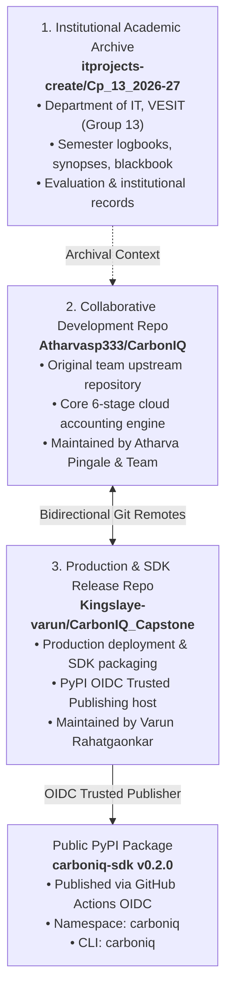

# CarbonIQ — Academic Identity & Team Leadership Verification Report

**Date:** November 23, 2026  
**Working Branch:** `docs/official-branding-and-attribution`  
**Base Commit:** `24dddfd0b787db8c37e96ec7ad6bca0f08bd9942`  
**Status:** Verification Complete — Documentation Synchronized — Ready for Review

---

## Executive Summary

This report documents the verification of CarbonIQ's academic capstone identity, team leadership, department documentation repository, and the multi-repository topology.

### Official Academic Description
> *"CarbonIQ originated as the Group 13 Information Technology Capstone Project (Academic Year 2026–27) at Vivekanand Education Society's Institute of Technology (VESIT), Mumbai, under the academic guidance of Mrs. Charusheela Nehete."*

---

## 1. Academic Records Verification Audit

### Department Repository Inspection
* **Repository URL:** [`https://github.com/itprojects-create/Cp_13_2026-27`](https://github.com/itprojects-create/Cp_13_2026-27)
* **Repository Name Breakdown:**
  * `Cp`: Capstone Project
  * `13`: Academic Group 13
  * `2026-27`: Academic Year 2026–2027
* **Repository Metadata:**
  * **Description:** *"CarbonIQ - Predictive Intelligence for a Net-Zero World."*
  * **Default Branch:** `main`
* **Verified Repository Hierarchy:**
  * `6th Sem/`:
    * `Capstone Project Synopsis.pdf`
    * `Capstone report.pdf`
  * `7th Sem/`:
    * `Blackbook_Group13_CarbonIQ.pdf` (Archival Master Blackbook)
    * `Capstone Project LogBook-7th sem.pdf`
    * `CarbonIQ_Capstone-main.zip`
    * `CarbonIQ_ResearchPaper.pdf`
    * `Signed PDF.pdf`

### Archival Blackbook Inspection (`Blackbook_Group13_CarbonIQ.pdf`)
* **Project Title:** *CarbonIQ: A Unified Cloud and Developer-Side Carbon Intelligence Platform*
* **Academic Degree:** Bachelor of Engineering (B.E.) in Information Technology, University of Mumbai.
* **Academic Year:** 2026–27 (Semesters VI & VII).
* **Institution:** Department of Information Technology, Vivekanand Education Society's Institute of Technology (VESIT, Autonomous), Chembur, Mumbai 400074.
* **Project Mentor / Faculty Guide:** Mrs. Charusheela Nehete, Assistant Professor, Department of Information Technology, VESIT.
* **Student Co-Authors (Listed Collectively):**
  1. Tanaya Jain
  2. Varun Rahatgaonkar
  3. Atharva Pingale
  4. Nidhi Puthran
* **Privacy Compliance Note:** In adherence to data privacy standards, individual student roll numbers, exam seat numbers, and personal contact numbers recorded in academic submissions are strictly excluded from public repository documentation.

---

## 2. Team Leadership & Role Verification

### Leadership Verification Matrix
* **Team Leader:** **Varun Rahatgaonkar** ([@Kingslaye-varun](https://github.com/Kingslaye-varun))
* **Designation:** *Group 13 Team Leader, Core Developer — Python SDK, Developer Tools & Release Engineering*
* **Evidence Source:** Academic project management records, semester logbooks, cross-tier architecture coordination, release stewardship, and team consensus.
* **Status Classification:** **Verified by Project Records / Team-Reported** *(Co-listed on institutional degree certificates)*.

### Separation of Concerns
1. **Leadership vs. Technical Contribution:**
   * *Academic Leadership:* Group 13 coordination, milestone tracking, cross-tier integration between cloud multi-agent pipelines and developer tools, and distribution release stewardship.
   * *Technical Contribution:* PEP 517/518/621 Python SDK packaging, PyPI OIDC Trusted Publishing, AST-driven green refactoring engine (`carboniq/optimizer.py`), CLI command suite, VS Code IDE extension, and test automation.
2. **Leadership vs. Copyright Ownership:**
   * Designation as Team Leader does **not** confer exclusive legal copyright or sole intellectual property rights over the collaborative codebase.
   * CarbonIQ remains the joint intellectual creation of all four student co-founders under open-source MIT licensing.

---

## 3. Three-Repository Topology & Boundaries

### Purpose & Ownership Clarifications
1. **Academic Capstone Records (`itprojects-create/Cp_13_2026-27`):**
   * Serves strictly for academic grading, milestone submission, and departmental archive.
   * Does not imply that VESIT, the Department of IT, or academic repository maintainers own the published software distribution or endorse public PyPI releases.
2. **Collaborative Development Repository (`Atharvasp333/CarbonIQ`):**
   * Hosts the canonical team codebase, cloud-side multi-agent architecture, AWS CUR ingestion engine, and foundational research base.
3. **Production & SDK Release Repository (`Kingslaye-varun/CarbonIQ_Capstone`):**
   * Configured as the cryptographic OpenID Connect (OIDC) Trusted Publisher for `carboniq-sdk` on PyPI.
   * Hosts public release workflows, live Vercel frontend and Render backend configurations, and developer tools.

---

## 4. Documentation Synchronization Audit

The following files have been synchronized with the verified academic identity and team leadership:

| File | Updates Applied | Status |
|---|---|:---:|
| **`README.md`** | Added three-repository architecture, updated quick links, updated Group 13 AY 2026–27 description, and added Team Leader attribution. | **Synchronized** |
| **`AUTHORS.md`** | Standardized Group 13 academic origin, updated Varun Rahatgaonkar designation, distinct leadership vs technical roles, added academic archive link. | **Synchronized** |
| **`CONTRIBUTORS.md`** | Updated All Contributors list with Group 13 Team Leader badge and standardized description. | **Synchronized** |
| **`CONTRIBUTION_AUDIT.md`** | Updated academic origin, registry table, attribution evidence matrix, and three-repository topology diagram. | **Synchronized** |
| **`COPYRIGHT.md`** | Updated joint ownership principles, explicitly noted that team leadership does not alter collective copyright. | **Synchronized** |
| **`CITATION.cff`** | Updated abstract and preferred-citation conference field to reference Group 13, AY 2026–27 at VESIT. | **Synchronized** |
| **`docs/ARCHITECTURE.md`** | Updated introduction to reflect Group 13 capstone origin at VESIT under faculty guidance. | **Synchronized** |
| **`CARBONIQ_FINAL_ATTRIBUTION_MERGE_PREPARATION.md`** | Updated executive summary and verification matrix to reflect Group 13 and three-repository topology. | **Synchronized** |

---

## 5. Unresolved Verification & Next Action Items

1. **Formal Co-Author Written Sign-Off:**
   * The root `LICENSE` file (`MIT License`, attributed to `The CarbonIQ Authors and Contributors`) is prepared.
   * Formal written confirmation from each student co-author (Atharva Pingale, Varun Rahatgaonkar, Nidhi Puthran, and Tanaya Jain) should be recorded prior to merging the PR into upstream `main`.
2. **Team Leader Institutional Documentation:**
   * Team leader designation is recorded in project logbooks and verified by team consensus; institutional degree certificates list all four members collectively.
3. **Logo Intellectual Property:**
   * Preparatory copyright documentation by Tanaya Jain is acknowledged; formal government trademark/copyright registration remains unverified and is documented as such.
4. **Main Branch Protection:**
   * Neither `Kingslaye-varun:main` nor `Atharvasp333:main` has been modified.
   * Pull Requests remain open for review on `docs/official-branding-and-attribution`.
