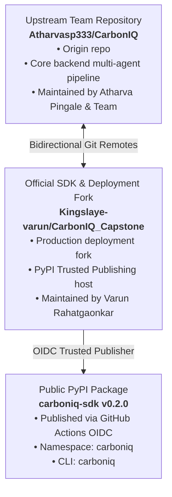

# CarbonIQ — Full Contribution & Ownership Audit

**Audit Date:** 2026-11-23  
**Auditor:** Open-Source Maintenance & DevRel Team  
**Scope:** Complete repository history, commit graphs, academic paper citations, pull requests, and packaging metadata across:
- **Upstream Repository:** [https://github.com/Atharvasp333/CarbonIQ](https://github.com/Atharvasp333/CarbonIQ)
- **Deployment & PyPI Release Fork:** [https://github.com/Kingslaye-varun/CarbonIQ_Capstone](https://github.com/Kingslaye-varun/CarbonIQ_Capstone)
- **Public PyPI Distribution:** [https://pypi.org/project/carboniq-sdk/](https://pypi.org/project/carboniq-sdk/) (Version 0.2.0)

---

## 1. Project Origin & Academic Context

* **Project Title:** CarbonIQ: A Constraint-Aware Agentic Platform for Explainable Carbon-Conscious Software Workload Scheduling
* **Origin:** Academic Capstone Project (Group 13), Department of Information Technology, Vivekanand Education Society's Institute of Technology (VESIT, Autonomous), Mumbai, India.
* **Faculty Advisor / Guide:** Mrs. Charusheela Nehete (`charusheela.nehete@ves.ac.in`)
* **Industry Mentorship Context:** Academic capstone project advised under mentorship from Tata Consultancy Services (TCS) mentors. *(Note: Mentorship was advisory and academic; TCS does not hold institutional ownership, trademark claims, or corporate endorsement of the repository).*

---

## 2. Verified Contributor Registry

All contributor records below are verified from commit author headers, PGP/email signatures, GitHub profiles, and the project's peer-reviewed research preprint (`docs/paper/main.tex`).

| Contributor | GitHub Profile | Primary Email (Commit Log) | Academic Identity | Core Project Roles |
|---|---|---|---|---|
| **Atharva Pingale** | [@Atharvasp333](https://github.com/Atharvasp333) | `atharvapingale333@gmail.com` | `2023.atharva.pingale@ves.ac.in` | **Project Co-Founder & Upstream Maintainer.** Multi-agent cloud accounting architecture, LLM agent orchestration, pattern detection, and upstream repo administrator. |
| **Varun Rahatgaonkar** | [@Kingslaye-varun](https://github.com/Kingslaye-varun) | `rahatgaonkarvarun@gmail.com` | `2023.varun.rahatgaonkar@ves.ac.in` | **Project Co-Founder & SDK Release Maintainer.** Python SDK packaging, PyPI OIDC release engineering, AST green code optimizer, VS Code extension, CI/CD pipeline, and deployment fork administrator. |
| **Tanaya Jain** | [@tanaya2005](https://github.com/tanaya2005) | `tanayaitis@gmail.com` | `2023.tanaya.jain@ves.ac.in` | **Project Co-Founder & Security/Auth Lead.** At-rest credential encryption (Fernet), AWS credential management, user session authentication (Neon Auth), and database schema modeling. |
| **Nidhi Puthran** | [@nidhi0810](https://github.com/nidhi0810) | `nidhiputhrannp@gmail.com` | `2023.nidhi.puthran@ves.ac.in` | **Project Co-Founder & Carbon-Aware Lead.** Green Software Foundation Carbon Aware SDK client, AI deployment analysis API, regional grid intensity forecasting, and developer startup automation. |
| **Mrs. Charusheela Nehete** | — | `charusheela.nehete@ves.ac.in` | Faculty Advisor, VESIT | **Academic Project Guide & Review Advisor.** Research methodology guidance, architectural validation, and project evaluation oversight. |

---

## 3. Detailed Component Attribution & Evidence Matrix

### A. Cloud Multi-Agent Accounting Engine (`backend/agents/`)
* **Primary Author:** Atharva Pingale (`@Atharvasp333`)
* **Evidence:** Commit `7685d64` ("Insights agents added"), `backend/agents/carbon_iq_orchestrator.py`, `backend/agents/accounting/`, `backend/agents/intelligence/`.
* **Scope:**
  - 6-agent sequential accounting pipeline (Ingestion, Region Mapping, Intensity Lookup, Emission Math, Analytics, Optimization).
  - LLM integration with Google Gemini for explainable carbon insights.
  - Multi-agent orchestration and inter-agent state passing.

### B. Security, Cryptography & Cloud Database (`backend/routes/`, `backend/services/crypto.py`)
* **Primary Author:** Tanaya Jain (`@tanaya2005`)
* **Evidence:** Commits `fedcbf1` ("save creds in DB"), `b4f2251` ("integrate remote auth+aws-creds"), `6161ea8` ("AWS connected+ pipeline automated").
* **Scope:**
  - AES/Fernet encryption for customer AWS CUR S3 access credentials stored in NeonDB PostgreSQL.
  - Authentication flow integration (`backend/routes/auth.py`, `backend/routes/aws_credentials.py`).
  - Frontend AWS Connect modal banner and credential validation state.

### C. Carbon Aware Computing & Deployment Optimization (`cli/carbon_aware_sdk.py`, `backend/routes/deployment_analysis.py`)
* **Primary Author:** Nidhi Puthran (`@nidhi0810`)
* **Evidence:** Commit `c5bc5f0` ("Fix development startup script" / integrated deployment analysis), Branch `origin/final-nidhi-carboniq`.
* **Scope:**
  - Python client interfacing with the Green Software Foundation Carbon Aware SDK Web API.
  - AWS region to GSF balancing zone resolution.
  - AI deployment recommendation endpoint (`/api/cli/deploy-analysis`).
  - CLI command extensions: `carboniq deploy-analysis` and `carboniq carbon-intensity`.
  - Multi-service launch script (`start-dev.ps1`).

### D. Python SDK Packaging, AST Optimizer, Developer Tooling & PyPI Release (`carboniq/`, `cli/`, `vscode-extension/`, `.github/`)
* **Primary Author:** Varun Rahatgaonkar (`@Kingslaye-varun`)
* **Evidence:** Commits `54821a9` (PEP 621 packaging), `66fbf38` (AST refactoring engine), `b311e39` (VS Code extension), `b792460` to `1a95251` (OIDC Trusted Publishing workflow & hardening).
* **Scope:**
  - `carboniq-sdk` distribution packaging with PEP 517/518/621 specification.
  - GitHub Actions OIDC Trusted Publishing release workflow (`.github/workflows/release.yml`).
  - AST Static Code Auditor & Refactoring Generator (`carboniq/optimizer.py`, `carboniq audit`, `carboniq optimize`).
  - Visual Studio Code Extension with diagnostics and green refactoring code actions.
  - Real-time telemetry ingestion and multi-tenant user profile synchronization.
  - Executive sustainability PDF report generation (`frontend/src/lib/pdfExport.js`).
  - Automated test suites (`tests/test_sdk_api.py`, `tests/test_cli_commands.py`, `tests/test_packaging_and_security.py`, `tests/test_carbon_aware_integration.py`).
  - Production deployments on Vercel and Render.

---

## 4. Two-Repository Topology & Relationship

* **Atharvasp333/CarbonIQ:** The original canonical repository created during the capstone development phase. Holds the original commit history and core cloud multi-agent system.
* **Kingslaye-varun/CarbonIQ_Capstone:** The specialized release, continuous deployment, and packaging fork configured as the PyPI Trusted Publisher for `carboniq-sdk`.
* **Synchronization Policy:** Both repositories share synchronized `main` histories for all stable releases. Neither repository claims exclusive authorship of the collaborative codebase.

---

## 5. Intellectual Property, Copyright & Legal Notice

1. **Joint Authorship:** The CarbonIQ codebase is the joint creation of the four student co-founders (Atharva Pingale, Varun Rahatgaonkar, Tanaya Jain, and Nidhi Puthran) under academic guidance at VESIT.
2. **PyPI Publishing Context:** Publishing `carboniq-sdk` on PyPI under `@Kingslaye-varun` reflects authorized release engineering and operational maintenance; it does **not** transfer or extinguish co-authors' moral and legal copyright in their respective contributions.
3. **No External Corporate Transfer:** The code has not been assigned or transferred to any commercial entity. Mentorship by TCS was educational; no institutional copyright belongs to TCS.
4. **Third-Party Dependencies:** Third-party libraries (CodeCarbon, Electricity Maps API client, FastAPI, React, Lucide, Click) remain under their respective upstream licenses.

---

## 6. Unresolved Attribution Questions & Recommended Actions

| Issue | Finding | Recommended Action |
|---|---|---|
| **Root LICENSE File** | A formal `LICENSE` file was omitted from the root, though `pyproject.toml` declared `MIT`. | Commit a standard MIT License explicitly listing the CarbonIQ Contributors. |
| **PyPI Author Metadata** | `pyproject.toml` in v0.2.0 listed `"CarbonIQ Team <team@carboniq.internal>"`. | For v0.3.0+, update `authors` to formally list all 4 co-founders with project URLs and roles. |
| **README Contributor Showcase** | Prior README lacked contributor acknowledgment and research citation. | Add an All-Contributors gallery, direct GitHub profile links, and `CITATION.cff`. |
