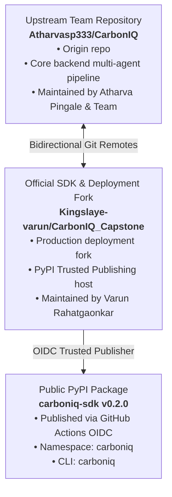

# CarbonIQ — Full Contribution & Ownership Audit

**Audit Date:** 2026-11-23  
**Auditor:** Open-Source Maintenance & DevRel Team  
**Scope:** Complete repository history, commit graphs, academic paper citations, pull requests, and packaging metadata across:
- **Upstream Repository:** [https://github.com/Atharvasp333/CarbonIQ](https://github.com/Atharvasp333/CarbonIQ)
- **Deployment & PyPI Release Fork:** [https://github.com/Kingslaye-varun/CarbonIQ_Capstone](https://github.com/Kingslaye-varun/CarbonIQ_Capstone)
- **Public PyPI Distribution:** [https://pypi.org/project/carboniq-sdk/](https://pypi.org/project/carboniq-sdk/) (Version 0.2.0)

---

## 1. Project Origin & Academic Context

> **Official Academic Description:**  
> *"CarbonIQ was developed as a final-year academic capstone project at Vivekanand Education Society's Institute of Technology (VESIT), Mumbai, by a four-member student team under the academic guidance of Mrs. Charusheela Nehete."*

* **Department:** Department of Information Technology, Vivekanand Education Society's Institute of Technology (VESIT, Autonomous), Chembur, Mumbai, Maharashtra, India.
* **Faculty Advisor / Project Guide:** Mrs. Charusheela Nehete (`charusheela.nehete@ves.ac.in`), Assistant Professor, Department of Information Technology, VESIT.
* **Mentorship & Affiliation Correction:** The project was an independent academic capstone developed under institutional faculty supervision. Preliminary exploratory discussions occurred with external industry professionals, but they were outside the scope of CarbonIQ and did not constitute project mentorship, advisory review, sponsorship, or institutional affiliation. There is no corporate or external institutional partnership associated with CarbonIQ.

---

## 2. Verified Contributor Registry

The project was co-founded by its four student contributors at VESIT:

| Contributor | GitHub Profile | Primary Email (Commit Log) | Academic Affiliation | Project Role & Designation |
|---|---|---|---|---|
| **Atharva Pingale** | [@Atharvasp333](https://github.com/Atharvasp333) | `atharvapingale333@gmail.com` | `2023.atharva.pingale@ves.ac.in` | **Core Developer — Cloud & AI Architecture** Upstream repository administrator ([Atharvasp333/CarbonIQ](https://github.com/Atharvasp333/CarbonIQ)). |
| **Varun Rahatgaonkar** | [@Kingslaye-varun](https://github.com/Kingslaye-varun) | `rahatgaonkarvarun@gmail.com` | `2023.varun.rahatgaonkar@ves.ac.in` | **Core Developer — Python SDK, Developer Tools & Release Engineering** Deployment & PyPI release fork administrator ([Kingslaye-varun/CarbonIQ_Capstone](https://github.com/Kingslaye-varun/CarbonIQ_Capstone)). |
| **Nidhi Puthran** | [@nidhi0810](https://github.com/nidhi0810) | `nidhiputhrannp@gmail.com` | `2023.nidhi.puthran@ves.ac.in` | **Core Developer — Carbon-Aware Computing** |
| **Tanaya Jain** | [@tanaya2005](https://github.com/tanaya2005) | `tanayaitis@gmail.com` | `2023.tanaya.jain@ves.ac.in` | **Research, Documentation & Intellectual Property** |
| **Mrs. Charusheela Nehete** | — | `charusheela.nehete@ves.ac.in` | Assistant Professor, VESIT | **Academic Project Guide & Faculty Advisor** |

---

## 3. Attribution Evidence Table

This table classifies project contributions across Git history, academic project documentation, team reporting, and verification status:

| Contributor | Contribution Area | Specific Deliverables | Git / Document Evidence | Verification Status |
|---|---|---|---|---|
| **Atharva Pingale** | Cloud Multi-Agent Accounting Architecture | 6-Agent accounting pipeline, orchestrator, ingestion, carbon intensity & emission agents, Google Gemini integration | Git commits `7685d64`, `1f89304`, `backend/agents/` | **Verified by Git** |
| **Atharva Pingale** | Upstream Repository Management | Original repository creation, initial commit tree, issue tracking | GitHub upstream remote `Atharvasp333/CarbonIQ` | **Verified by Git** |
| **Atharva Pingale** | Academic Research Paper | Co-author on capstone research preprint | `docs/paper/main.tex` author list | **Verified by project document** |
| **Varun Rahatgaonkar** | Python SDK Packaging & PyPI Launch | PEP 517/518/621 packaging, GitHub Actions OIDC Trusted Publishing, PyPI `carboniq-sdk` v0.2.0 | Git commits `54821a9` to `1a95251`, `.github/workflows/release.yml`, PyPI release | **Verified by Git** |
| **Varun Rahatgaonkar** | AST Sustainable Code Optimizer | `carboniq/optimizer.py`, `carboniq audit`, `carboniq optimize`, AST refactoring engine | Git commits `66fbf38`, `2e35299`, `carboniq/optimizer.py` | **Verified by Git** |
| **Varun Rahatgaonkar** | VS Code Extension & Developer Tooling | Inline AST linting, code actions, CLI architecture, automated test suites (36 tests) | Git commits `b311e39`, `6ffaeb7`, `vscode-extension/`, `tests/` | **Verified by Git** |
| **Varun Rahatgaonkar** | Academic Research Paper | Co-author on capstone research preprint | `docs/paper/main.tex` author list | **Verified by project document** |
| **Nidhi Puthran** | Carbon-Aware Computing | Green Software Foundation Carbon Aware SDK client, regional grid intensity lookup | Git commit `c5bc5f0`, branch `origin/final-nidhi-carboniq`, `cli/carbon_aware_sdk.py` | **Verified by Git** |
| **Nidhi Puthran** | AI Deployment Analysis & CLI | `/api/cli/deploy-analysis`, `carboniq deploy-analysis`, `carboniq carbon-intensity`, `start-dev.ps1` | Git commit `c5bc5f0`, `backend/routes/deployment_analysis.py` | **Verified by Git** |
| **Nidhi Puthran** | Academic Research Paper | Co-author on capstone research preprint | `docs/paper/main.tex` author list | **Verified by project document** |
| **Tanaya Jain** | Capstone Blackbook & Academic Documentation | Master capstone blackbook compilation, academic progress updates, testing documentation | Project reports, `docs/Blackbook_Group13_CarbonIQ.pdf`, `carboniq-update1.md` | **Verified by project document / Team-reported** |
| **Tanaya Jain** | Research Paper Preparation | Co-author on capstone research preprint | `docs/paper/main.tex` author list | **Verified by project document** |
| **Tanaya Jain** | Intellectual Property & Logo Work | IPR documentation, logo copyright-related preparation and filing work | Team capstone reports | **Team-reported** *(Formal registration grant unverified)* |
| **Tanaya Jain** | Frontend UI & Credential Security Commits | UI page layouts (`Login.jsx`, `Signup.jsx`, `Home.jsx`), Fernet crypto helper (`crypto.py`), AWS credentials route commits | Git commits `fedcbf1`, `b4f2251`, `6161ea8`, `928ad13`, `7a608b1` | **Verified by Git** |
| **Mrs. Charusheela Nehete** | Academic Faculty Guidance | Capstone faculty guide and advisor, methodology oversight | `docs/paper/main.tex` author list, VESIT project guide record | **Verified by project document** |

*Verification Status Definitions:*
* **Verified by Git:** Commits present in Git commit history with verifiable author headers, timestamps, and file diffs.
* **Verified by project document:** Formally recorded in academic research papers (`docs/paper/main.tex`), project blackbooks, or institutional records.
* **Team-reported:** Attributed based on unanimous project team reporting where work was performed collaboratively or outside Git commit tracking.
* **Unverified:** Pending official third-party documentary evidence (e.g., formal government copyright registration certificates).

---

## 4. Two-Repository Topology & Relationship

* **Atharvasp333/CarbonIQ:** The original canonical repository created during the capstone development phase. Holds the original commit history and core cloud multi-agent system.
* **Kingslaye-varun/CarbonIQ_Capstone:** The specialized release, continuous deployment, and packaging fork configured as the PyPI Trusted Publisher for `carboniq-sdk`.
* **Synchronization Policy:** Both repositories share synchronized `main` histories for all stable releases. Neither repository claims exclusive authorship of the collaborative codebase.

---

## 5. Intellectual Property, Copyright & Legal Status

1. **Joint Authorship:** The CarbonIQ software and research are the collective intellectual creation of the four student co-founders (Atharva Pingale, Varun Rahatgaonkar, Tanaya Jain, and Nidhi Puthran) under academic guidance at VESIT.
2. **PyPI Publishing Context:** Publishing `carboniq-sdk` on PyPI under `@Kingslaye-varun` reflects authorized release engineering and operational maintenance; it does **not** transfer or extinguish co-authors' moral and legal copyright in their respective contributions.
3. **No Commercial Assignment:** The code has not been assigned or transferred to any commercial entity.
4. **Third-Party Dependencies:** Third-party libraries (CodeCarbon, Electricity Maps API client, FastAPI, React, Click) remain under their respective upstream permissive licenses.
