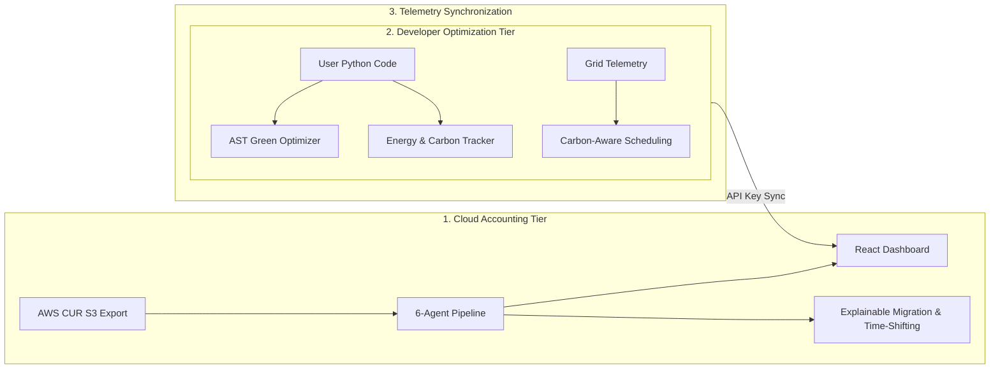

# 🌱 CarbonIQ

> **Unified Cloud Infrastructure & Developer-Side Carbon Intelligence Platform**

[](https://pypi.org/project/carboniq-sdk/)
[](https://pypi.org/project/carboniq-sdk/)
[](https://github.com/Kingslaye-varun/CarbonIQ_Capstone/actions/workflows/release.yml)
[](LICENSE)
[](https://carboniq-capstone.vercel.app)
[](https://carboniq-backend-duel.onrender.com/docs)
[](https://neon.tech)

CarbonIQ unites macro-level cloud infrastructure accounting with micro-level developer compute optimization. It automatically ingests AWS Cost & Usage Reports (CUR) through a deterministic six-stage multi-agent pipeline, correlates regional workloads with real-time electric grid telemetry, and empowers engineers with an autonomous Python SDK, an AST-driven green refactoring optimizer, a developer CLI, and VS Code IDE diagnostics.

---

### 🌐 Quick Links & Resources

* **Public PyPI Package:** [`pip install carboniq-sdk`](https://pypi.org/project/carboniq-sdk/) (Version 0.2.0)
* **Production Web Dashboard:** [https://carboniq-capstone.vercel.app](https://carboniq-capstone.vercel.app)
* **Production API Swagger Docs:** [https://carboniq-backend-duel.onrender.com/docs](https://carboniq-backend-duel.onrender.com/docs)
* **Deployment & Release Repository:** [Kingslaye-varun/CarbonIQ_Capstone](https://github.com/Kingslaye-varun/CarbonIQ_Capstone)
* **Original Upstream Repository:** [Atharvasp333/CarbonIQ](https://github.com/Atharvasp333/CarbonIQ)
* **Academic Citation:** [CITATION.cff](CITATION.cff) | [Authors](AUTHORS.md) | [Architecture](docs/ARCHITECTURE.md)

---

## Why CarbonIQ?

1. **The Cloud Visibility Gap:** Enterprise cloud billing reports (like AWS CUR) contain millions of usage records but lack location-aware electric grid carbon intensity data.
2. **The Developer Disconnect:** Developers write software without visibility into the carbon intensity of the regions where their code executes or the energetic cost of computational anti-patterns.
3. **Actionable Governance:** CarbonIQ closes the loop by providing verifiable Scope 2 carbon accounting at the cloud level alongside proactive, automated AST green refactoring at the developer workstation level.

---

## Platform Overview



---

## System Architecture & Multi-Agent Pipeline

CarbonIQ executes a deterministic six-stage multi-agent pipeline to process raw cloud billing exports:

```
Raw AWS CUR (CSV / CSV.GZ)
  │
  ▼
Agent 1 — Ingestion & Normalization
  Filter non-compute rows (taxes, credits, support), normalize usage units,
  and compress 5,000+ line items into daily service/region records.
  │
  ▼
Agent 2 — Region Mapping
  Translate proprietary cloud regions into electric grid balancing authority zones
  (e.g., ap-south-1 → IN-WE, us-west-2 → US-NW-PACW).
  │
  ▼
Agent 3 — Carbon Intensity Lookup
  Query historical and real-time gCO₂/kWh from Electricity Maps with deduplicated
  caching and empirical regional fallback baselines.
  │
  ▼
Agent 4 — Deterministic Emission Calculation
  Compute Scope 2 emissions: UsageAmount × ServicePowerFactor × CarbonIntensity / 1000
  (Empirical factors: EC2 0.15 kWh/hr, Lambda 0.0001 kWh/GB-s, S3 0.0005 kWh/GB).
  │
  ▼
Agent 5 — Analytics & Aggregation
  Compute Pareto service distributions, regional emissions, and time-series trends.
  │
  ▼
Agent 6 — Optimization & Explainable Intelligence
  Rank regional migration and time-shifting opportunities against organizational constraints;
  generate audit-ready human explanations via Google Gemini.
```

---

## Features

### 1. Cloud Web Dashboard & Enterprise Analytics
* **Automated AWS CUR S3 Sync:** Symmetrically encrypts credentials at rest (Fernet/AES) and automatically streams daily CUR billing exports.
* **Service Emissions Breakdown:** Interactive Pareto charts for EC2, Glue, Lambda, RDS, and S3.
* **What-If Scenario Simulator:** Interactively project emissions savings when moving workloads to cleaner regions.
* **Executive PDF Export:** Generate publication-ready compliance reports directly in the browser with vector graphics.

### 2. Python SDK & Developer CLI (`carboniq`)
* **AST Static Code Auditor:** Analyze Python scripts without execution for 4 energy-draining anti-patterns (nested append loops, unvectorized math, uncached recursion, large list materialization) and assign an A–F sustainability score.
* **Automated Green Refactoring:** Generate optimized, energy-efficient replacements using list comprehensions, memoization, and streaming generators.
* **Workload Energy Profiling:** Measure duration, energy (kWh), and carbon emissions (gCO2e) using CodeCarbon hardware telemetry or a calibrated 65W TDP baseline model.
* **Carbon-Aware Scheduling:** Advisory ranking of cloud regions and time windows by electric grid carbon intensity.
* **Authenticated Cloud Sync:** Push local CLI measurements to your personal web dashboard using persistent API keys.

### 3. Visual Studio Code Extension
* **Inline AST Diagnostics:** Real-time squiggly warnings highlighting energy-draining patterns upon saving.
* **One-Click Quick Fixes:** Code actions providing instant side-by-side visual diffs to accept green code transformations.
* **Status Bar Efficiency Badge:** Instant visual feedback of the active file's sustainability grade.

---

## Installation

### Core SDK and CLI
Install the official package from PyPI:

```bash
pip install carboniq-sdk
```

### Optional Hardware Telemetry
To enable direct physical Intel RAPL hardware power tracking on bare-metal Linux/Windows systems:

```bash
pip install "carboniq-sdk[hardware]"
```

*Note: On virtual machines or unprivileged environments, CarbonIQ automatically uses a calibrated 65W TDP CPU/RAM energy estimation model.*

---

## Quick Start

### 1. Audit a Python Script for Energy Inefficiencies
```bash
carboniq audit my_script.py
```

### 2. Automatically Generate Optimized Green Code
```bash
# Preview suggested transformations
carboniq optimize my_script.py

# Or apply improvements in-place
carboniq optimize my_script.py --in-place
```

### 3. Profile Workload Execution & Carbon Emissions
```bash
carboniq measure python my_script.py
```

### 4. Query Regional Carbon Intensity Guidance
```bash
carboniq recommend-schedule -d 60 -r us-east-1 -r us-west-2 -r eu-west-1 -r ap-south-1
```

---

## Complete CLI Command Reference

| Command | Usage | Description |
|---|---|---|
| `audit` | `carboniq audit <file.py>` | Run AST static analysis to detect energy anti-patterns and score efficiency (A–F). |
| `optimize` | `carboniq optimize <file.py> [--in-place]` | Automatically refactor code into an energy-efficient equivalent. |
| `measure` | `carboniq measure <cmd>` | Measure execution time, energy (kWh), and carbon emissions (gCO2e). |
| `compare` | `carboniq compare <cmd_a> <cmd_b>` | Run two commands side-by-side and contrast energy and runtime differences. |
| `recommend-schedule` | `carboniq recommend-schedule -d <min> -r <reg>` | Rank cloud regions and time windows by forecast carbon intensity. |
| `deploy-analysis` | `carboniq deploy-analysis <cmd>` | Profile workload and query GSF Carbon Aware SDK for optimal deployment advice. |
| `carbon-intensity` | `carboniq carbon-intensity -r <region>` | Look up real-time electric grid carbon intensity for a cloud region. |
| `monitor` | `carboniq monitor -r <region>` | Continuously stream real-time grid carbon intensity. |
| `config` | `carboniq config set-key <key>` | Configure API keys and backend synchronization endpoints. |

---

## Python SDK Examples

### Decorator Workload Tracking
```python
from carboniq import track

@track(project_name="model-inference", measure_power_secs=1)
def run_heavy_inference(data):
    # Your compute-intensive workload
    return [x ** 2 for x in data]

results = run_heavy_inference(range(100_000))
```

### Context Manager Workload Tracking
```python
from carboniq import track

with track(project_name="batch-pipeline") as t:
    process_batch()

print(f"Energy used: {t.final_emissions_data.energy_consumed:.6f} kWh")
print(f"Emissions:   {t.final_emissions_data.emissions * 1000:.2f} gCO2e")
```

### Programmatic AST Code Auditing & Optimization
```python
from carboniq import audit_code, optimize_code

source_code = """
def process(items):
    out = []
    for x in items:
        out.append(x * 2)
    return out
"""

# Static Audit
report = audit_code(source_code)
print(f"Grade: {report['grade']} (Score: {report['score']}/100)")
print(f"Anti-patterns detected: {len(report['anti_patterns'])}")

# Automated Green Refactoring
optimized_source, diff = optimize_code(source_code)
print("Optimized Code:\n", optimized_source)
```

---

## Carbon Calculation & Optimization Methodology

### Scope 2 Emission Math
CarbonIQ computes market- and location-based Scope 2 greenhouse gas emissions using the standard Greenhouse Gas Protocol formula:

$$\text{Emissions (gCO}_2\text{e)} = \text{Energy (kWh)} \times \text{Grid Carbon Intensity (gCO}_2/\text{kWh)}$$

For cloud billing line items (CUR), energy is calculated from usage metrics and empirical service power factors:
* **Amazon EC2:** $0.15\text{ kWh per vCPU-hour}$ (active computational draw).
* **AWS Lambda:** $0.0001\text{ kWh per GB-second}$.
* **Amazon S3:** $0.0005\text{ kWh per GB-month}$ (storage drive idle/read power).

### Static Analysis vs Physical Hardware Measurements
> [!IMPORTANT]
> **Methodological Clarification:**
> * **Static AST Efficiency Grades (A–F):** Structural heuristics based on computational complexity rules (e.g., eliminating array reallocations or redundant recursion). They highlight code-level optimization opportunities and do not represent direct physical watt-hour measurements.
> * **Hardware Telemetry:** Direct physical energy readings obtained when Intel RAPL sensors are accessible on bare-metal platforms.
> * **Baseline Estimation Model:** On virtualized cloud instances (where hypervisors restrict RAPL access), CarbonIQ applies a calibrated 65W TDP baseline CPU/RAM model to ensure deterministic reporting without throwing execution errors.

### Grid Intensity Data Sources
* **Live Telemetry:** Real-time balancing authority grid intensity queried directly from the **Electricity Maps API** or the **Green Software Foundation Carbon Aware SDK**.
* **Empirical Fallbacks:** Calibrated regional averages (e.g., Mumbai `ap-south-1` at $708\text{ gCO}_2/\text{kWh}$, Ireland `eu-west-1` at $105\text{ gCO}_2/\text{kWh}$, Oregon `us-west-2` at $220\text{ gCO}_2/\text{kWh}$) applied deterministically whenever external network APIs are unreachable or offline.

---

## Two-Repository Architecture

CarbonIQ is developed across two synchronized GitHub repositories:

* **[Atharvasp333/CarbonIQ](https://github.com/Atharvasp333/CarbonIQ):** The original upstream repository created during the academic capstone initiative. Holds the foundation multi-agent cloud accounting system and research base. Maintained by Atharva Pingale.
* **[Kingslaye-varun/CarbonIQ_Capstone](https://github.com/Kingslaye-varun/CarbonIQ_Capstone):** The specialized deployment and distribution fork configured as the public PyPI Trusted Publisher for `carboniq-sdk`. Maintained by Varun Rahatgaonkar.

Both repositories maintain synchronized release histories. Detailed evidence is documented in [CONTRIBUTION_AUDIT.md](CONTRIBUTION_AUDIT.md).

---

## Authors & Contributors

CarbonIQ was developed as a final-year academic capstone project at Vivekanand Education Society's Institute of Technology (VESIT), Mumbai, by a four-member student team under the academic guidance of Mrs. Charusheela Nehete:

<!-- ALL-CONTRIBUTORS-LIST:START - Do not remove or modify this section -->
| Contributor | Profile | Key Focus Areas |
|:---:|:---:|:---|
| **Atharva Pingale** | [@Atharvasp333](https://github.com/Atharvasp333) | 💻 🏗️ 📦 Core Developer — Cloud & AI Architecture, Upstream Repository Maintainer |
| **Varun Rahatgaonkar** | [@Kingslaye-varun](https://github.com/Kingslaye-varun) | 💻 🚀 🧪 Core Developer — Python SDK, Developer Tools & Release Engineering |
| **Nidhi Puthran** | [@nidhi0810](https://github.com/nidhi0810) | 💻 🌍 📊 Core Developer — Carbon-Aware Computing |
| **Tanaya Jain** | [@tanaya2005](https://github.com/tanaya2005) | 📖 📋 ⚖️ Research, Documentation & Intellectual Property, UI & Crypto Commits |
| **Mrs. Charusheela Nehete** | — | 🧑‍🏫 🔬 Faculty Advisor & Research Supervision, Assistant Professor, Department of IT, VESIT |
<!-- ALL-CONTRIBUTORS-LIST:END -->

For complete contributor details and contribution guidelines, see [AUTHORS.md](AUTHORS.md), [CONTRIBUTORS.md](CONTRIBUTORS.md), and [CONTRIBUTING.md](CONTRIBUTING.md).

---

## Research Citation

If you use CarbonIQ in academic research, software benchmarks, or sustainable cloud computing studies, please cite our work using the format below (or via [CITATION.cff](CITATION.cff)):

```bibtex
@inproceedings{carboniq2026,
  title     = {CarbonIQ: A Constraint-Aware Agentic Platform for Explainable Carbon-Conscious Software Workload Scheduling},
  author    = {Jain, Tanaya and Rahatgaonkar, Varun and Pingale, Atharva and Puthran, Nidhi and Nehete, Charusheela},
  booktitle = {Capstone Research / Under Review},
  year      = {2026},
  url       = {https://github.com/Kingslaye-varun/CarbonIQ_Capstone}
}
```

---

## Security & Privacy

* **Zero Plaintext Credentials:** AWS Access Keys stored in NeonDB are symmetrically encrypted using Fernet (AES-128-CBC + HMAC-SHA256).
* **OIDC Trusted Publishing:** Package publication to PyPI uses cryptographic OpenID Connect tokens; zero permanent PyPI API tokens exist in repository secrets.
* **Safe Static Analysis:** Code auditing parses Python AST without executing untrusted scripts.

To report a vulnerability, please review our [Security Policy](SECURITY.md).

---

## License & Copyright

CarbonIQ is open-source software licensed under the **MIT License** (see [LICENSE](LICENSE) and [COPYRIGHT.md](COPYRIGHT.md)).

```
Copyright (c) 2026 The CarbonIQ Authors and Contributors
```

See [COPYRIGHT.md](COPYRIGHT.md) for full intellectual property disclosures, third-party acknowledgments, and licensing analysis.

---

## Acknowledgments

* **Vivekanand Education Society's Institute of Technology (VESIT):** Department of Information Technology, Mumbai, India.
* **Faculty Project Advisor:** Mrs. Charusheela Nehete, Assistant Professor, Department of Information Technology, VESIT.
* **Open Source Ecosystem:** Built with pride upon [FastAPI](https://fastapi.tiangolo.com/), [CodeCarbon](https://codecarbon.io/), [Electricity Maps](https://www.electricitymaps.com/), [Green Software Foundation](https://greensoftware.foundation/), [Neon](https://neon.tech/), and [React](https://react.dev/).
