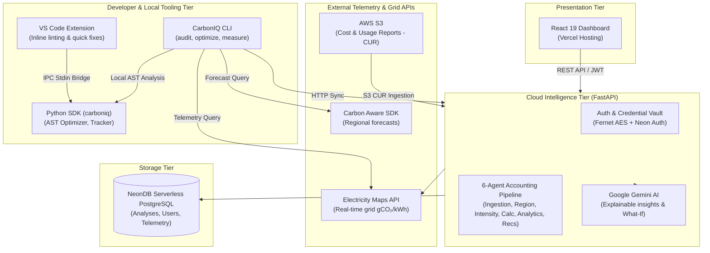
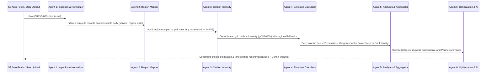

# CarbonIQ Architecture

CarbonIQ bridges macro-level cloud infrastructure accounting with micro-level developer compute optimization. Originated as the Group 13 Information Technology Capstone Project (Academic Year 2026–27) at Vivekanand Education Society's Institute of Technology (VESIT), Mumbai, under the academic guidance of Mrs. Charusheela Nehete, this document provides an architectural overview of its subsystems, multi-agent pipeline, and data flows.

---

## High-Level System Architecture

---

## 1. Cloud-Side: Six-Agent Accounting Pipeline

The cloud backend ingests raw AWS Cost and Usage Reports (CUR CSV or CSV.GZ) and executes a deterministic 6-agent sequential pipeline:

### Agent Responsibilities:
1. **Agent 1 (Ingestion & Normalization):** Parses multi-megabyte CUR files, filters non-compute items (taxes, credits, support fees), and aggregates usage rows.
2. **Agent 2 (Region Mapping):** Translates proprietary cloud region identifiers into electric grid balancing authority zones.
3. **Agent 3 (Carbon Intensity):** Queries real-time and historical grid emissions data from Electricity Maps, backed by empirical regional fallback baselines.
4. **Agent 4 (Emission Calculation):** Calculates Scope 2 market/location-based emissions utilizing empirical hardware power draw factors (e.g., EC2 baseline $0.15\text{ kWh/vCPU-hr}$, Lambda $0.0001\text{ kWh/GB-s}$).
5. **Agent 5 (Analytics):** Computes Pareto distributions, regional distributions, and time-series aggregations.
6. **Agent 6 (Optimization & Explainability):** Evaluates region-shifting and time-shifting potential against organizational policy constraints.

---

## 2. Developer-Side: Python SDK, AST Optimizer & CLI

The developer tier operates locally on user machines and CI/CD runners:

### A. AST Sustainable Code Optimizer (`carboniq/optimizer.py`)
* Parses Python source code into an Abstract Syntax Tree (AST) using Python's native `ast` module.
* Detects structural anti-patterns:
  * Repeated `list.append()` inside loops (recommends pre-allocation or list comprehensions).
  * Unvectorized iterative math (recommends NumPy vectorization).
  * Uncached recursive function calls (recommends `@lru_cache`).
  * Unbounded eager list materialization (recommends generator streaming).
* Generates refactored, syntax-valid replacement code using AST transformation nodes.

### B. Execution Tracker (`carboniq/tracker.py`)
* Wraps CodeCarbon hardware emission tracking.
* Dynamically detects whether physical Intel RAPL / hardware sensors are available.
* In virtualized or unprivileged environments, automatically applies a calibrated 65W TDP baseline CPU/RAM model to ensure deterministic measurement without throwing errors.

### C. VS Code Extension Architecture (`vscode-extension/`)
* Runs as a native TypeScript VS Code extension.
* Communicates with the installed `carboniq` Python binary via standard input/output (stdio JSON IPC).
* Emits inline code diagnostics (`DiagnosticCollection`) and provides one-click `CodeActionProvider` fixes with side-by-side visual diffs.

---

## 3. Security & Telemetry Isolation

* **Isolated Package Namespace:** The published PyPI distribution packages only the `carboniq` namespace and exports the `carboniq` console entry point. No generic top-level namespace (`cli`) is installed into `site-packages`.
* **Zero Long-Lived PyPI Tokens:** Automated package releases use OpenID Connect (OIDC) identity federation with GitHub Actions Trusted Publishing.
* **Encrypted AWS Credentials:** All AWS access credentials stored in NeonDB are symmetrically encrypted at rest using Fernet (AES-128-CBC with HMAC-SHA256).
